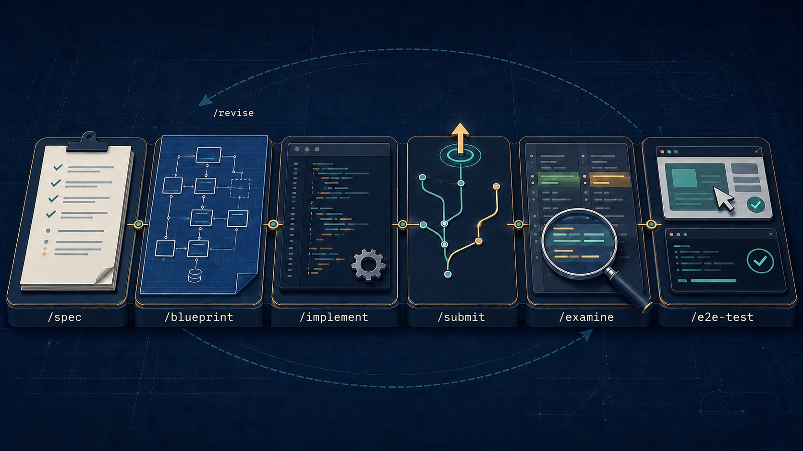

# swd: software development skills



swd is a plugin of skills that take a change from a fuzzy request to a merged pull request. Each skill runs one stage: spec, plan, investigate, rebase, submit, review, revise, or test. Nine skills are shipped and one is planned. The plugin runs on Claude Code, Codex CLI, and any [Agent Plugins](https://agent-plugins.org/) client.

| Skill | What it does | Say |
| --- | --- | --- |
| **[/spec](./skills/spec)** | Turns a feature request into a product spec: goals, non-goals, and acceptance criteria with stable IDs. Later skills cite the IDs. | "/spec", "spec this out", "write a product spec". |
| **[/blueprint](./skills/blueprint)** | Plans a change after it checks every assumption against the code and the specs. The plan's first two sections are enough to accept or reject it. | "/blueprint", "plan this thoroughly", "deep plan". |
| **[/rca](./skills/rca)** | Finds the root cause of a failure: a repro, a timeline, a 5-whys chain with evidence, and a sweep for siblings. It proposes a symptom fix and a cause fix, and a way to prevent the class. | "/rca", "root cause", "5 whys", "why is this failing". |
| **[/repo-docs](./skills/repo-docs)** | Creates or extends `AGENTS.md` and `docs/`, so coding agents read the project's conventions instead of guessing them. | "document the project for coding agents", "add AGENTS.md". |
| **[/rebase](./skills/rebase)** | Replays commits onto a new base and keeps their intent, the invariants, and the conventions intact. Conflict resolution is the smallest part. | "rebase this branch on X", "move these commits onto the new base". |
| **[/submit](./skills/submit)** | Turns finished work into a draft PR with green CI. It makes a feature branch and Conventional Commits, and runs the pre-push checks. The description opens with what the reviewer decides on. | "/submit", "open a PR", "push this up". Use it instead of `git push` or `gh pr create`. |
| **[/examine](./skills/examine)** | Reviews a PR, a branch, or the working tree for production risk first. The host's own review finds defects. This one also judges the intent, the approach, and the size. | "/examine", "review this PR", "check my PR before merge". |
| **[/revise](./skills/revise)** | Answers review feedback instead of obeying it. It checks every claim against the code and the specs. Each finding gets a verdict with evidence: ACCEPT, PARTIAL, REJECT, or DEFER. Accepted items are fixed at the root, and the reply goes where the feedback lives. | "/revise", "address the review", "respond to the reviewer". |
| **[/e2e-test](./skills/e2e-test)** | Tests the product the way its user does: a web app in the browser, a CLI through its binary, a library through consumer programs. It reports each case as PASS, FAILURE, or BLOCKED, and fixes nothing. | "/e2e-test", "test it as the end user", "test it in the browser". |
| **/implement** | Runs an approved blueprint step by step, with tests per step. This one is still on the drawing board. | Nothing yet. Progress is in [#27](https://github.com/korya/swd-skills/issues/27). |

In Claude Code, type the slash command or say one of the triggers. In Codex, every skill is a namespaced mention, such as `$swd:spec` or `$swd:submit`.

## Install

**Claude Code**, in the session:

```sh
/plugin marketplace add korya/swd-skills
/plugin install swd@swd
```

**Codex CLI**, in the shell, with Codex 0.145 or later:

```sh
codex plugin marketplace add korya/swd-skills
codex plugin add swd@swd
```

The first command registers `github.com/korya/swd-skills` as a marketplace. The second installs the plugin `swd` from the marketplace `swd`. The marketplace is named `swd` in `.claude-plugin/marketplace.json`, which is why the target is `swd@swd` and not the repo name.

## Update

**Claude Code:**

```sh
/plugin marketplace update swd
```

**Codex CLI:**

```sh
codex plugin marketplace upgrade swd
```

The Codex command refreshes the Git snapshot and the installed copy under `~/.codex/plugins/cache/`. It works only for an unpinned marketplace. If you added the marketplace with `--ref <sha>`, re-add it without the ref.

## Other hosts

The skills are portable, and the packaging is not. OpenCode, pi, Grok Build, and Muse Code read a `SKILL.md` with YAML frontmatter, but none of them installs this plugin. The `skills` CLI from [skills.sh](https://www.skills.sh/korya/swd-skills) copies the nine skills into the agent's skills directory:

```sh
npx skills add korya/swd-skills
```

Add `-a <agent>` to choose the agent and `-g` to install for every project. Without the CLI, clone the repo and point the agent at `skills/`.

| Host | Reads |
| --- | --- |
| OpenCode | `.opencode/skills/`, `.claude/skills/`, `.agents/skills/`, and the same paths under `~/` |
| pi | `~/.pi/agent/skills/`, `~/.agents/skills/`, `.agents/skills/` |
| Muse Code | `~/.agents/skills/`, `.agents/skills/`, or `muse skills import --from claude` |
| Grok Build | `.claude/` skills, `AGENTS.md`, hooks, MCP |

`~/.agents/skills/` is the nearest thing to a vendor-neutral location. Symlink `skills/*` there, and most of the table is covered.

## Develop

### Install from a checkout

```sh
git clone https://github.com/korya/swd-skills.git
```

**Claude Code:**

```sh
/plugin marketplace add /absolute/path/to/swd-skills
/plugin install swd@swd
```

Run `/reload-plugins` after you edit a skill.

**Codex CLI:**

```sh
codex plugin marketplace add /absolute/path/to/swd-skills
codex plugin add swd@swd
```

Codex copies the plugin into `~/.codex/plugins/cache/`, so your edits are not live. Re-run `codex plugin add swd@swd` after each edit, then start a new Codex session.

### Check before you push

```sh
python3 scripts/validate.py
python3 -m unittest discover -s tests
```

The validator checks both manifests and every skill. The tests cover the validator itself and the prose linter. CI runs both, each host's own validator, and the prose linter on the skills and `assets/`.

Codex loads at most 8,000 bytes of a `SKILL.md`, frontmatter included, and drops the rest without a warning. It also cuts a description past 1,024 characters in its catalog ([#10](https://github.com/korya/swd-skills/issues/10)). The validator prints each skill's budget, warns from 90% of a limit, and fails the build past it. Keep `SKILL.md` a skeleton of steps, and put the depth into `references/` files that the skill reads at the step that needs them.

A release bumps the version in both `plugin.json` and `.claude-plugin/marketplace.json`, in `metadata.version` and in the plugin entry. The validator fails when the two files disagree. Codex reads the installed version from `plugin.json`, so a stale value stalls updates for Codex users.

### Layout

```
plugin.json          # Agent Plugins 1.0.0 manifest, read by Codex and other AP clients
.claude-plugin/
  marketplace.json   # marketplace manifest and plugin definition, read by Claude Code
skills/
  <name>/
    SKILL.md         # the core, under 8 KB, read whole by every host
    references/      # the depth, read at the step that needs it
hooks/
  hooks.json         # the Claude Code hooks the plugin installs with itself
  guard-pr.py        # PreToolUse: refuses a bare `gh pr create` unless /submit is running
assets/
  writing.md         # the writing rules for every skill and every document it produces
scripts/
  validate.py        # manifest and budget checks, run by CI on every push
  prose-lint.py      # mechanical check of the writing rules, run by CI on skills and assets
tests/               # unit tests for the validator and the linter
evals/               # per-skill eval fixtures and benchmarks, in the skill-creator format
LICENSE              # AGPL-3.0-or-later
```

The plugin ships a single hook, and only Claude Code runs it. `hooks/guard-pr.py` refuses a bare `gh pr create` and tells the agent to run `/submit` instead. `/submit` sets a marker, `$GIT_DIR/swd-submit`, in its first phase and removes it in its last. The hook accepts the command while the marker exists and is under four hours old. Without the hook, an agent that knows the `gh pr create` pattern skips the PR body, the screenshots, and the CI gate that `/submit` owns. Hosts without hooks rely on the skill description, which states the same rule.

Each host reads its own manifest. Claude Code reads `.claude-plugin/marketplace.json` and ignores `plugin.json`. Codex reads `plugin.json` first and rejects a wrong `$schema` outright. CI runs both hosts' own validators. `scripts/validate.py` adds the checks that neither host makes:

- the two manifests name the same version
- the marketplace lists exactly the skills in `skills/`
- no skill names a host-specific tool
- every `SKILL.md` fits Codex's budget

`assets/writing.md` holds the writing rules for every skill and every document a skill writes. The claim comes first, sentences stay short, and each concept has one term. `scripts/prose-lint.py` checks the mechanical half of those rules, and CI runs it on the skills and the rule file. Each skill has an eval under `evals/` that measures a rewrite against the previous version.
