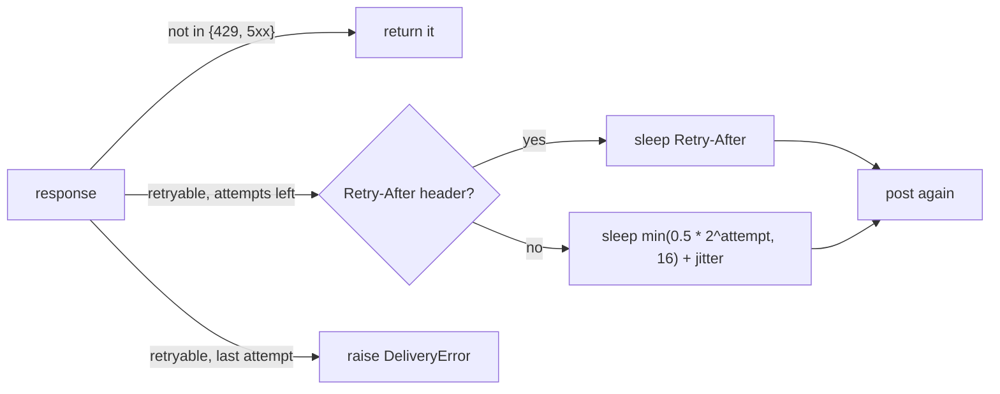

## Why

Under gateway trouble nearly one send in eleven is lost, and every tenant gets a free 429 storm once a minute.

Two things conspire. `Sender` retries any 5xx exactly three times with a fixed 1 s pause, so an outage longer than 3 s becomes a `DeliveryError`, and every client retries on the same beat. `FixedWindowLimiter` lets a tenant spend its whole 100/min quota in the first second of each minute, which the gateway answers with a burst of 429s that the sender then treats as a non-retryable success (`status < 500`). In the load test (10k sends, 20% injected 5xx, a 429 storm at minute 3) that adds up to 91.2% delivery and 1,840 429s per run.

## What & how

Retry with exponential backoff that honours `Retry-After`, and throttle each tenant with a token bucket instead of a fixed window.

| Metric (median of 3 runs, 10k sends) | before | after |
|---|---|---|
| Delivery success | 91.2% | **99.1%** |
| 429 responses per run | 1,840 | **12** |
| p50 latency | 120 ms | 120 ms |
| p99 latency | 3.4 s | **9.8 s** |
| Worst-case wait per message | 3 s | **31 s** |
| Per-tenant cap | 100/min, fixed window | 60/min sustained, burst 20 |

The trade: roughly 800 more messages per 10k get delivered and the 429 storm all but disappears, paid for with a p99 that triples and a worst case ten times longer, because the sender now waits for the gateway instead of giving up. Who it hits:

- **Front-loading tenants.** Anyone sending 100 messages in the first second of a minute is now throttled after 20 and drains at 1/s. Three tenants on staging do exactly this; they need a heads-up before this ships to prod.
- **Lower sustained cap.** 100/min becomes 60/min sustained. A tenant that spread 100/min evenly was never throttled before and will be now.
- **Breaking API.** `FixedWindowLimiter` is gone from `notify`; `Sender(delay=...)` no longer exists. Defaults move from 3 attempts / 3 s total to 5 attempts / 7.5 s total.
- **No new dependencies**; `random` is stdlib.

Details a reviewer should not miss:

- The backoff schedule alone caps total waiting at 0.5 + 1 + 2 + 4 = 7.5 s. The 31 s worst case in the table can therefore only come from honouring gateway `Retry-After` values during the 429 storm. That is intended: the gateway knows when it will accept traffic again, we do not. If 31 s is too long for the back office, the lever is a cap on `Retry-After`, not on the backoff.
- Jitter defaults to 0 so tests stay deterministic; production wiring should pass `jitter > 0` to break up the thundering herd. This PR does not change the production wiring.
- Retryable statuses are an explicit set (`{429, 500, 502, 503, 504}`) rather than `>= 500`, so 501 and 505 are returned to the caller like any other non-retryable response.
- The bucket refills continuously (`tokens += elapsed * rate`), so a tenant that pauses recovers burst capacity gradually rather than all at once on a minute boundary; that is the whole point, and the reason the 429 count collapses.

Out of scope: per-tenant rate configuration (every tenant gets the same 1/s + 20 burst), and a migration path for the three front-loading staging tenants.

## Other changes

- `docs/BENCHMARKS.md` gains the after column and the note on affected tenants.
- README: fix a "recieve" typo.
- Tests rewritten for the new behaviour: backoff doubling, `Retry-After` override, non-429 4xx not retried, bucket burst/refill/tenant isolation.

🤖 Generated with [Claude Code](https://claude.com/claude-code)
