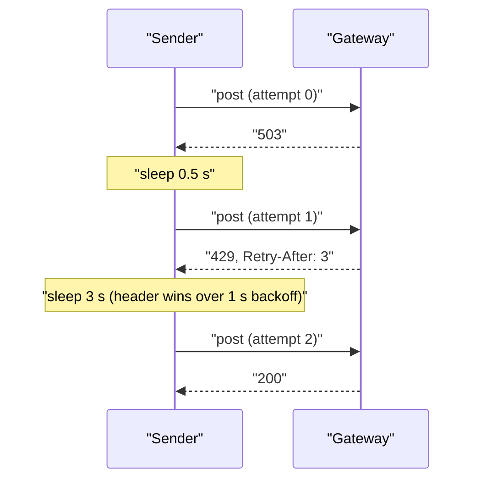

## Why

Under gateway pressure almost one send in eleven is lost: the load test shows 91.2% delivery success and 1,840 `429` responses per 10,000 sends.

Two things compound. `Sender` retries a fixed three times, one second apart, and only on 5xx, so a `429` is returned as a failure on the first attempt and a 5xx storm is hammered at a constant cadence. `FixedWindowLimiter` lets a tenant spend its whole 100/min quota in the first second of each minute and then blocks it for the remaining 59, which is exactly the burst pattern that triggers the gateway's `429` storm.

## What & how

Retries now back off exponentially (0.5 s doubling to a 16 s cap, optional jitter), treat `429` as retryable, and obey a `Retry-After` header when the gateway sends one. Per-tenant limiting moves from a fixed window to a token bucket: 60/min sustained with a burst of 20, so traffic is smoothed instead of front-loaded.

Load test, 10,000 sends with 20% injected 5xx and a `429` storm at minute 3, median of three runs (full table in `docs/BENCHMARKS.md`):

| | before | after |
|---|---|---|
| Delivery success | 91.2% | **99.1%** |
| `429` responses per 10k sends | 1,840 | **12** |
| p50 latency | 120 ms | 120 ms |
| p99 latency | 3.4 s | **9.8 s** |
| Worst-case wait per message | 3 s | **31 s** |
| Per-tenant cap | 100/min, fixed window | 60/min sustained, burst 20 |

The trade: a message that would have failed now mostly gets through, but the slow tail gets slower; p99 almost triples and a message can sit for half a minute before `DeliveryError` is raised. Callers with a tighter deadline need to pass a smaller `retries` or `max_delay`. Three tenants on staging rely on sending 100 messages in the first second of each minute; they are now throttled after 20 and drain at one per second. `FixedWindowLimiter` is removed from the public API rather than kept beside the new limiter. No new dependencies.

Details a reviewer should weigh:

- `Retry-After` is read as a number of seconds and used verbatim, with no cap and no HTTP-date support. A gateway that sends `Retry-After: 600` will be obeyed. The staging gateway only sends small integer values, so this is an accepted simplification, not an oversight.
- `jitter` defaults to `0.0`, so out of the box many senders backing off from the same outage still retry in lockstep. The benchmark ran with the default; enabling jitter is a one-argument change for callers that want it.
- The retry count default goes from 3 to 5. Pure backoff accounts for only 7.5 s of waiting (0.5 + 1 + 2 + 4 across the four gaps); the measured 31 s worst case comes from honouring the gateway's `Retry-After` values during the `429` storm, which the old sender never did because it failed on the first `429`.
- The bucket is in-process and per tenant; nothing is shared across processes. That matches the previous limiter, so horizontal scaling behaves as before.

Out of scope: a compatibility shim for `FixedWindowLimiter`, migrating the three bursty staging tenants, and distributed rate limiting.

## Other changes

- Tests rewritten for the new behaviour: burst-then-block, refill at rate, independent tenants; backoff schedule, `Retry-After` override, non-`429` 4xx not retried.
- `README.md`: fix the "recieve" typo (separate commit).
