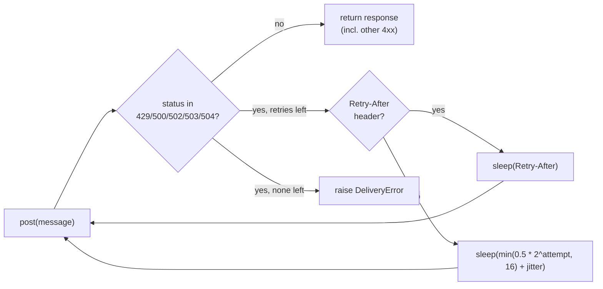

## Why

Under gateway trouble, nearly one in ten notifications is lost, and tenants that burst get a wall of 429s every minute.

The sender retried three times, one second apart, and only on 5xx; a 429 went straight back to the caller as a failure. The per-tenant limiter was a fixed 100-per-minute window, so a tenant could fire 100 messages in the first second of every minute and the gateway answered the rest of that second with 429s. In the 10k-send staging load test (20% injected 5xx, a 429 storm at minute 3) this came out to 91.2% delivery and 1,840 429s per 10k sends.

## What & how

Retries now back off exponentially and honor `Retry-After`, and the per-tenant limiter is a token bucket (sustained 60/min, burst 20) instead of a fixed window.

| Metric (10k sends, median of 3 runs) | before | after |
|---|---|---|
| Delivery success | 91.2% | 99.1% |
| 429 responses per 10k sends | 1,840 | 12 |
| p50 latency | 120 ms | 120 ms |
| p99 latency | 3.4 s | 9.8 s |
| Worst-case wait per message | 3 s | 31 s |
| Per-tenant cap | 100/min, fixed window | 60/min sustained, burst 20 |

The trade: messages that used to fail fast now wait and get delivered, so the tail latency roughly triples and the worst case grows tenfold. Who feels it: three staging tenants send their whole minute's quota in the first second; they are now throttled after 20 and drain at one per second. `FixedWindowLimiter` is removed, not deprecated; the package export changes with it. No new dependencies (`random` is stdlib).

Decisions a reviewer should weigh:

- **Why a token bucket rather than a tighter fixed window?** A smaller window still gates traffic at boundaries; the bucket smooths it, which is what drops 429s from 1,840 to 12. The burst of 20 is a judgment call against the 100 the old window allowed; it is the knob to raise if the three affected tenants cannot adapt.
- **Why remove the old limiter instead of keeping both?** Single consumer, small package; keeping the fixed window around invites the burst pattern back in.
- **Why 5 retries at base 0.5 s?** Four waits total 7.5 s under pure backoff; the 31 s worst case comes from honoring long `Retry-After` values during the 429 storm. Callers with a latency budget should pass `retries` / `max_delay` explicitly.
- **Jitter defaults to 0** so existing callers and tests see deterministic timing; the benchmark does not record which jitter setting the load test used.
- **Retry-After is parsed as seconds only** (`float(...)`); the HTTP-date form would raise `ValueError`, and a large value is not capped by `max_delay`. Neither is exercised by the current gateway, but both are worth a follow-up before a different gateway sits behind this.

Out of scope: per-tenant override of rate/burst, metrics for throttled sends, and notifying the three affected tenants (that needs to happen before this deploys).

## Other changes

- `docs/BENCHMARKS.md` gains the after column and the note about affected tenants.
- README: spelling fix (`recieve` -> `receive`).
- Tests cover burst-then-block, refill at rate, tenant independence, doubling backoff, `Retry-After` override, and non-429 4xx not being retried.
