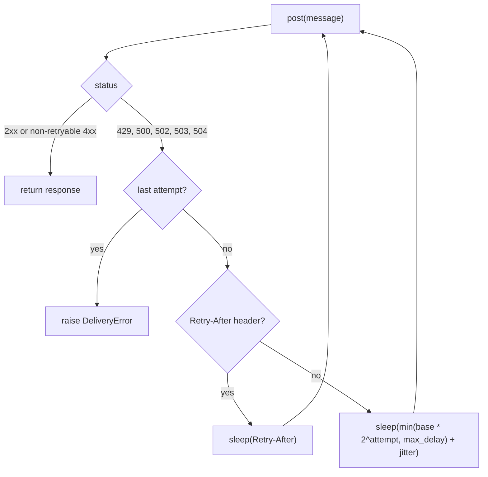

## Why

Nearly one in eleven back-office notifications fails to deliver when the gateway is under load. 429 storms are routine.

The load test in `docs/BENCHMARKS.md` sends 10,000 messages against staging. It injects 20% 5xx responses and a 429 storm at minute 3. On `main`, 8.8% of those sends end in `DeliveryError`. The gateway answers 1,840 of them with 429.

Two behaviours on `main` cause this. The sender retries three times, one second apart, and only on 5xx. A 429 fails immediately, and the retries that do happen all land at the same cadence. The limiter counts sends per fixed minute window. A tenant can send its whole 100-message quota in the first second and then nothing for 59 seconds.

## What & how

The sender now retries 429 and transient 5xx with a doubling delay, and honours the gateway's `Retry-After` header. The limiter is now a token bucket: 1 token per second per tenant, burst of 20. `FixedWindowLimiter` is gone from the public API.

| | before | after |
|---|---|---|
| Delivery success | 91.2% | 99.1% |
| 429 responses per 10k sends | 1,840 | 12 |
| p50 latency | 120 ms | 120 ms |
| p99 latency | 3.4 s | 9.8 s |
| Worst-case wait per message | 3 s | 31 s |
| Per-tenant cap | 100/min, fixed window | 60/min sustained, burst 20 |
| Retry budget | 3 attempts, 2 s | 5 attempts, 7.5 s plus any `Retry-After` |

The trade: 8 points more delivery success and 150 times fewer 429s, paid for with a slower tail. The p99 almost triples and the worst case grows ten times. Tenants that burst more than 20 messages at once are throttled after 20 and drain at one per second. Three staging tenants do this today. The sustained cap also drops from 100 to 60 per minute. New dependency: none, `random` is standard library.

Details a reviewer should not miss, in descending importance:

- `Retry-After` is not capped by `max_delay`. The computed delays sum to at most 7.5 s across five attempts. The 31 s worst case in the table therefore most likely comes from `Retry-After` values the gateway sent. If a long gateway-dictated wait is unacceptable, the cap should apply to it too.
- `Retry-After` is parsed with `float()`. The header may also carry an HTTP date, which would raise `ValueError` out of `send()` instead of `DeliveryError`. The staging gateway sends seconds, so the load test did not exercise this.
- Jitter defaults to `0.0`. The docstring promises jitter, but a caller gets none unless they pass `jitter=`. Retries from many workers that fail at the same moment will still line up.
- The bucket state lives in process memory, keyed by tenant, as the fixed window did. Nothing is shared across workers. This is unchanged and deliberately out of scope.
- The `Sender` docstring says `Retry-After` is honoured on 429 or 503. The code honours it on every retryable status.

## Other changes

- `README.md`: spelling fix, "recieve" to "receive".
