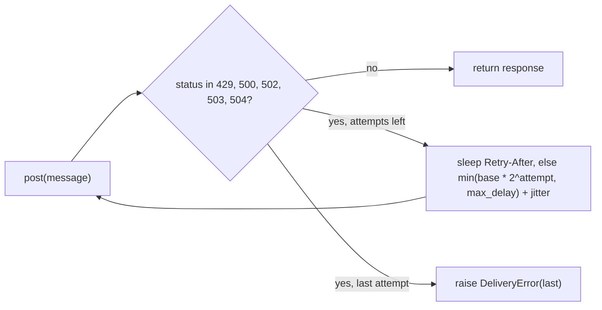

## Why

When the gateway is flaky, about one message in eleven never arrives, and tenants still trigger 429 storms.

The load test in `docs/BENCHMARKS.md` sends 10,000 messages against staging. It injects 20% 5xx responses and a 429 storm at minute 3. On the old code it delivered 91.2% of the messages and drew 1,840 rate-limit rejections per run.

Two designs caused this. The sender retried only on 5xx, three times, one second apart. A 429 went straight back to the caller, and a three-second outage outlived the retries. The limiter counted sends in a fixed minute. A tenant could post its whole quota of 100 in the first second and then hammer a closed window.

## What & how

The sender now retries on 429 and 5xx with exponential backoff, and a Retry-After header overrides the computed delay. The per-tenant limiter becomes a token bucket, which smooths each tenant to a sustained rate with a bounded burst.

| | before | after |
|---|---|---|
| Delivery success | 91.2% | 99.1% |
| p50 latency | 120 ms | 120 ms |
| p99 latency | 3.4 s | 9.8 s |
| 429 responses per 10k sends | 1,840 | 12 |
| Worst-case wait per message | 3 s | 31 s |
| Per-tenant cap | 100/min, fixed window | 60/min sustained, burst 20 |
| Retries, max delay | 3 at 1 s each | 5 at 0.5, 1, 2, 4 s, capped at 16 s |
| Public API | `FixedWindowLimiter` | `TokenBucketLimiter`, no alias |
| New dependencies | none | none |

The trade: the tail gets slower so that more messages arrive. The p99 nearly triples and the worst case for one message grows from 3 s to 31 s. Three staging tenants burst 100 sends in the first second of each minute. They are now cut off after 20 and drain at one per second. The sustained cap also drops from 100 to 60 per minute, and the benchmark ran only at these values.

Details a reviewer should weigh, in descending importance:

- The rename is loud on purpose. An alias named `FixedWindowLimiter` would keep old call sites compiling while silently changing their throttling, so importers must switch to `TokenBucketLimiter` by hand.
- Jitter defaults to 0. Callers get no jitter until they pass `jitter=`, which keeps the tests deterministic but means production opts in.
- Retry-After is read as seconds and is not capped by `max_delay`. An HTTP-date value in that header raises `ValueError` instead of a retry.
- The bucket lives in the process, as the window did before it. Several workers for one tenant each hold their own bucket, so the effective cap is per worker.
- `allow()` still returns a bool and the caller still decides what a refused send does. Queueing or shedding refused sends is out of scope.

## Other changes

- `docs/BENCHMARKS.md` gains the after column and a note on the three affected tenants.
- README: "recieve" becomes "receive", in its own commit.
