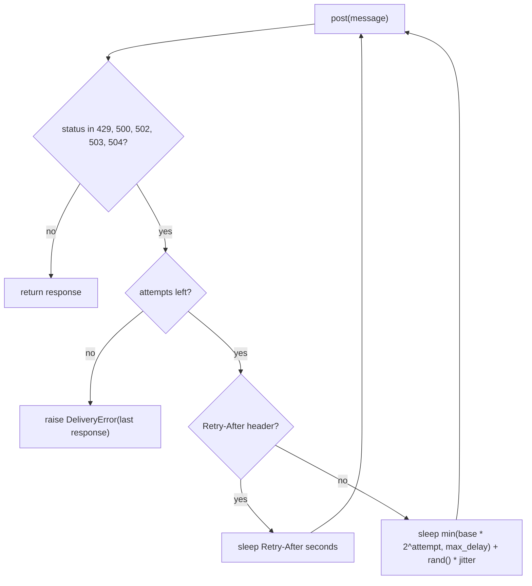

## Why

Under gateway errors about one notification in eleven is lost, and bursting tenants trigger 429 storms at the gateway.

The sender retried every 5xx three times with a fixed one second wait and gave up. It returned 429 to the caller without a retry. The limiter was a fixed window of 100 sends per minute per tenant. A tenant could send all 100 in the first second of each minute, and the gateway answered with 429 storms. The load test in `docs/BENCHMARKS.md` injects 20% 5xx responses and a 429 storm at minute 3. On the old code it delivered 91.2% of 10,000 sends and drew 1,840 responses with status 429.

## What & how

The sender now retries 429 and the 5xx family with exponential backoff and honors `Retry-After`. The limiter is now a token bucket: a sustained rate per tenant plus a burst allowance. Both ship with new defaults, measured on the same load test.

| | before | after |
|---|---|---|
| Delivery success | 91.2% | 99.1% |
| 429 responses per 10k sends | 1,840 | 12 |
| p50 latency | 120 ms | 120 ms |
| p99 latency | 3.4 s | 9.8 s |
| Worst-case wait per message | 3 s | 31 s |
| Per-tenant cap | 100/min, fixed window | 60/min sustained, burst 20 |
| Retry attempts | 3, fixed 1 s apart | 5, 0.5 s doubling to a 16 s cap |

Side effects, good and bad:

- Delivery success rises by 7.9 points and 429 responses fall by 99%.
- The p99 latency nearly triples and a message can wait up to 31 s instead of 3 s. The sender holds the caller while it backs off.
- The sustained cap per tenant drops from 100 to 60 per minute. Three staging tenants send 100 messages in the first second of each minute. They are now throttled after 20 and drain at one per second.
- `FixedWindowLimiter` is removed and `TokenBucketLimiter` takes its place in the package exports. Importers of the old name break at import time.
- The `Sender` constructor changes: `delay` becomes `base`, `max_delay`, `jitter`, and `rand`. The default `retries` moves from 3 to 5.
- No new dependencies. `random` and `time` come from the standard library.

The retry loop in one picture:

Assumptions a reviewer should check:

- `Retry-After` is parsed as a number of seconds. The HTTP-date form of the header raises `ValueError` inside `send`. The staging gateway sends seconds.
- The default `jitter` is 0, so the default sender backs off on a fixed schedule. Callers that want retries spread out pass `jitter` explicitly.
- The sender no longer sleeps after its last failed attempt. The old code slept once more before raising.

Deliberately out of scope:

- The limiter is not wired into `Sender`. Callers compose the two, as before.
- The three staging tenants above the new sustained cap are not migrated or contacted here.
- Support for the HTTP-date form of `Retry-After`.

## Other changes

- `docs/BENCHMARKS.md` now holds the before and after columns and names the affected tenants.
- README: fix the spelling of "receive".
