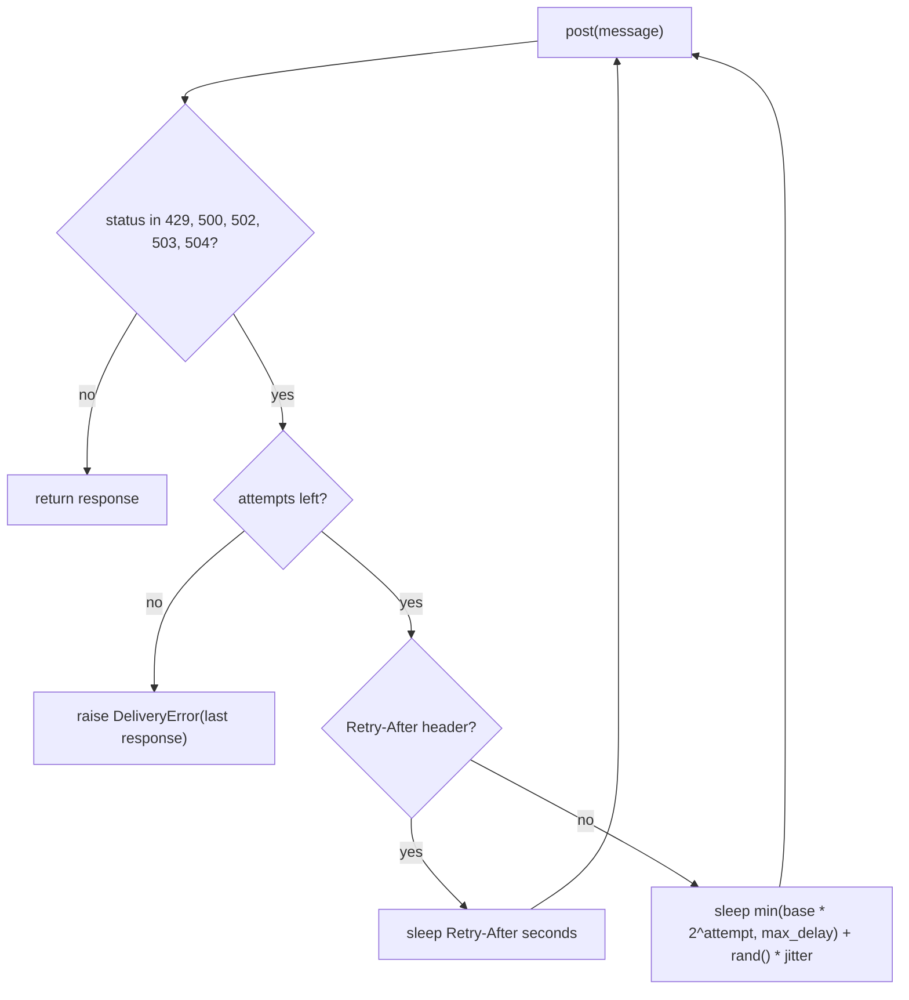

# Transcript: eval-1-fresh-rework-with-tradeoffs, with_skill, run-3

## Task prompt

First run `bash /Users/dmitri/dev/swd-skills/evals/submit/make_fixture.sh OUTPUT_DIR/fx fresh`, then work inside OUTPUT_DIR/fx/repo (branch main, with my uncommitted changes). I finished the retry and rate-limit rework for acme-notify; the load-test numbers are in docs/BENCHMARKS.md. Submit it for review. This environment has no GitHub: `origin` is the local bare repo at OUTPUT_DIR/fx/origin.git and the `gh` CLI must not be used. Where the workflow would create a PR, write the title to OUTPUT_DIR/pr-title.txt and the body to OUTPUT_DIR/pr-body.md instead. Where it would wait for CI, say that CI is unavailable here and stop.

OUTPUT_DIR = /Users/dmitri/dev/swd-skills/evals/submit/workspace/iteration-1/eval-1-fresh-rework-with-tradeoffs/with_skill/run-3/outputs

Skill used: the snapshot at /private/tmp/claude-501/-Users-dmitri-dev-swd-skills/bcd43507-277f-4180-96e1-e6c4ff0d39e4/scratchpad/snap/new/skills/submit (SKILL.md, references/commits.md, references/pr-description.md, references/rationalizations.md, ../../assets/writing.md, ../../scripts/prose-lint.py). references/screenshots.md was not read: nothing in the branch renders.

## Shell commands

All paths below are under OUTPUT_DIR unless absolute. `$D` is `fx/repo/.git`, `$LINT` is the snapshot's `scripts/prose-lint.py`.

1. `cat .../assets/writing.md; cat .../references/commits.md; ls .../scripts/` -- read the writing rules and commit reference (an `echo ======` separator failed in zsh, harmless).
2. `cat .../references/pr-description.md; cat .../references/rationalizations.md` -- read the PR description and rationalizations references.
3. `mkdir -p OUTPUT_DIR && bash /Users/dmitri/dev/swd-skills/evals/submit/make_fixture.sh OUTPUT_DIR/fx fresh` -- fixture created; 7 modified tracked files, `.env` and `scratch.py` untracked.
4. `cat .../references/commits.md; cat .../references/rationalizations.md; ls .../scripts/` -- re-read after the separator failure; scripts are `prose-lint.py` and `validate.py`.
5. `touch "$(git rev-parse --git-dir)/swd-submit" && git status && git branch -a && git log --oneline -10 && git remote -v && git config user.name && git config user.email && find ... && cat .env && cat scratch.py && cat .gitignore` -- phase 0: on `main` in sync with origin, one prior commit, user "Fixture Bot", `.env` holds `NOTIFY_API_KEY`, `scratch.py` is a probe marked "delete me", no `.gitignore` (cat exit 1).
6. `git diff --stat && git diff` -- read the full uncommitted diff.
7. `cat Makefile README.md docs/BENCHMARKS.md tests/fakes.py; ls -a .github; ls -a` -- `make test` and `make lint` are the repo's checks; no PR template.
8. `sed -n 1,80p .../scripts/prose-lint.py` -- learned the linter's usage and rules.
9. `git checkout -b fixture-backoff-token-bucket && make lint && make test` -- branch created; lint clean; 7 tests OK.
10. Wrote `$D/msg1..msg4` via heredocs, then `python3 "$LINT" "$D/$m"` for each -- msg1, msg2, msg4 clean; msg3 had one long-lead finding (22 words).
11. Rewrote `$D/msg3`, `python3 "$LINT" "$D/msg3"`, then `git add notify/sender.py tests/test_sender.py && git commit -q -F "$D/msg1"`, `git add notify/ratelimit.py notify/__init__.py tests/test_ratelimit.py && git commit -q -F "$D/msg2"`, `git add docs/BENCHMARKS.md && git commit -q -F "$D/msg3"`, `git add README.md && git commit -q -F "$D/msg4"`, `git status --short`, `git log --oneline origin/main..HEAD`, `make lint && make test`, `git push -u origin fixture-backoff-token-bucket`, `git rev-parse HEAD origin/fixture-backoff-token-bucket` -- lint clean; four commits recorded; checks still green; branch pushed; HEAD matches the remote.
12. `printf ... >| OUTPUT_DIR/pr-title.txt`, heredoc `>| OUTPUT_DIR/pr-body.md`, `python3 "$LINT" OUTPUT_DIR/pr-body.md`, `wc -c pr-title.txt` -- body has 0 findings; title is 65 characters.
13. `rm -f "$(git rev-parse --git-dir)/swd-submit" && git status --short --branch && git log --format='%h %s' origin/main..HEAD` -- marker removed; branch in sync; `.env`, `scratch.py`, and two `__pycache__/` dirs remain untracked.
14. This command: wrote `OUTPUT_DIR/../transcript.md`.

## Commit messages

### 031ee3d

```
feat(sender): Retry with exponential backoff and honor Retry-After

Previously the sender retried three times with a fixed one second wait and
retried every 5xx. Now it retries five times with a delay of base * 2**attempt
seconds, capped at max_delay, plus optional jitter. A Retry-After header on the
response overrides the computed delay.

The retryable set is now explicit: 429, 500, 502, 503 and 504. Other 4xx
responses return to the caller on the first attempt. The sender no longer
sleeps after the final failed attempt.

The defaults wait at most 7.5 seconds across the four backoff delays. A
Retry-After header can wait longer. The load test in docs/BENCHMARKS.md shows
the effect on delivery and latency.

Co-Authored-By: Claude Fable 5.1 <noreply@anthropic.com>
```

### 6764724

```
feat(ratelimit): Replace the fixed window with a token bucket

Previously FixedWindowLimiter allowed 100 sends per tenant per minute and reset
the count at the window edge. A tenant could send its whole quota in the first
second and then nothing, which produced 429 storms upstream. Now
TokenBucketLimiter allows a sustained rate with a burst allowance.

The default is a rate of 1 per second with a burst of 20. That is 60 per minute
sustained instead of 100, so tenants that burst above 20 now drain at one per
second. The package exports TokenBucketLimiter in place of FixedWindowLimiter,
which is a breaking change for importers of the old name.

Co-Authored-By: Claude Fable 5.1 <noreply@anthropic.com>
```

### c6118c4

```
docs(benchmarks): Record the load test for backoff and token bucket

The table now compares the old and the new retry and limiter on the same load
test. Delivery success rises from 91.2% to 99.1% and 429 responses fall from
1,840 to 12 per 10k sends. The p99 latency rises from 3.4 s to 9.8 s and the
worst-case wait from 3 s to 31 s.

The note at the end names the tenants affected by the lower sustained cap.

Co-Authored-By: Claude Fable 5.1 <noreply@anthropic.com>
```

### a313bc4

```
docs(readme): Fix the spelling of "receive"

Co-Authored-By: Claude Fable 5.1 <noreply@anthropic.com>
```

## PR title

```
feat(notify): Add exponential backoff and a token bucket limiter
```

## PR body

See `outputs/pr-body.md` (copied verbatim below).

````markdown
## Why

Under gateway errors about one notification in eleven is lost, and bursting tenants trigger 429 storms at the gateway.

The sender retried every 5xx three times with a fixed one second wait and gave up. It returned 429 to the caller without a retry. The limiter was a fixed window of 100 sends per minute per tenant. A tenant could send all 100 in the first second of each minute, and the gateway answered with 429 storms. The load test in `docs/BENCHMARKS.md` injects 20% 5xx responses and a 429 storm at minute 3. On the old code it delivered 91.2% of 10,000 sends and drew 1,840 responses with status 429.

## What & how

The sender now retries 429 and the 5xx family with exponential backoff and honors `Retry-After`. The limiter is now a token bucket: a sustained rate per tenant plus a burst allowance. Both ship with new defaults, measured on the same load test.

| | before | after |
|---|---|---|
| Delivery success | 91.2% | 99.1% |
| 429 responses per 10k sends | 1,840 | 12 |
| p50 latency | 120 ms | 120 ms |
| p99 latency | 3.4 s | 9.8 s |
| Worst-case wait per message | 3 s | 31 s |
| Per-tenant cap | 100/min, fixed window | 60/min sustained, burst 20 |
| Retry attempts | 3, fixed 1 s apart | 5, 0.5 s doubling to a 16 s cap |

Side effects, good and bad:

- Delivery success rises by 7.9 points and 429 responses fall by 99%.
- The p99 latency nearly triples and a message can wait up to 31 s instead of 3 s. The sender holds the caller while it backs off.
- The sustained cap per tenant drops from 100 to 60 per minute. Three staging tenants send 100 messages in the first second of each minute. They are now throttled after 20 and drain at one per second.
- `FixedWindowLimiter` is removed and `TokenBucketLimiter` takes its place in the package exports. Importers of the old name break at import time.
- The `Sender` constructor changes: `delay` becomes `base`, `max_delay`, `jitter`, and `rand`. The default `retries` moves from 3 to 5.
- No new dependencies. `random` and `time` come from the standard library.

The retry loop in one picture:



Assumptions a reviewer should check:

- `Retry-After` is parsed as a number of seconds. The HTTP-date form of the header raises `ValueError` inside `send`. The staging gateway sends seconds.
- The default `jitter` is 0, so the default sender backs off on a fixed schedule. Callers that want retries spread out pass `jitter` explicitly.
- The sender no longer sleeps after its last failed attempt. The old code slept once more before raising.

Deliberately out of scope:

- The limiter is not wired into `Sender`. Callers compose the two, as before.
- The three staging tenants above the new sustained cap are not migrated or contacted here.
- Support for the HTTP-date form of `Retry-After`.

## Other changes

- `docs/BENCHMARKS.md` now holds the before and after columns and names the affected tenants.
- README: fix the spelling of "receive".
````

## Final message to the user

Submitted as far as this environment allows. Branch `fixture-backoff-token-bucket` is pushed to the local origin with four commits, the PR title and body are written to the output files, and CI is unavailable here, so the workflow stops before the CI gate.

**Phase 0.** You were on `main`, in sync with origin, with seven modified tracked files and two untracked ones. No PR existed and the repo has no PR template.

**Commits** (one per logical change, all lint clean, checks green before and after):

| Commit | Subject |
|---|---|
| 031ee3d | feat(sender): Retry with exponential backoff and honor Retry-After |
| 6764724 | feat(ratelimit): Replace the fixed window with a token bucket |
| c6118c4 | docs(benchmarks): Record the load test for backoff and token bucket |
| a313bc4 | docs(readme): Fix the spelling of "receive" |

**PR.** Title: `feat(notify): Add exponential backoff and a token bucket limiter`. Saved to `/Users/dmitri/dev/swd-skills/evals/submit/workspace/iteration-1/eval-1-fresh-rework-with-tradeoffs/with_skill/run-3/outputs/pr-title.txt` and `.../outputs/pr-body.md`. The glance block puts the trade-off up front: delivery 91.2% to 99.1% and 429s 1,840 to 12, against p99 3.4 s to 9.8 s, worst-case wait 3 s to 31 s, and a sustained cap of 60/min that throttles three staging tenants. It would open as a draft; nothing is marked ready.

**CI.** Unavailable here. Stopped. `make lint` and `make test` (7 tests) pass locally.

Things I want you to look at:

1. **Why 60/min instead of 100/min?** The body states the new cap and its impact, but neither the code nor the benchmarks say why the sustained rate dropped. A reviewer will ask. Give me the reason and I will add it to the body.
2. **`Retry-After` as an HTTP date raises `ValueError`** inside `send`. The body lists it as an assumption and out of scope. If the gateway can send dates, that is a bug, not an assumption.
3. **Default `jitter` is 0**, so production backs off on a fixed schedule unless callers set it. Intentional?
4. **Left in the tree, uncommitted:** `.env` (contains `NOTIFY_API_KEY`) and `scratch.py` (your "delete me" probe). The repo has no `.gitignore`, so `.env` is one careless `git add -A` away from the remote. Worth a tiny follow-up.
5. `make test` left `notify/__pycache__/` and `tests/__pycache__/` behind. Same `.gitignore` fix covers them.
