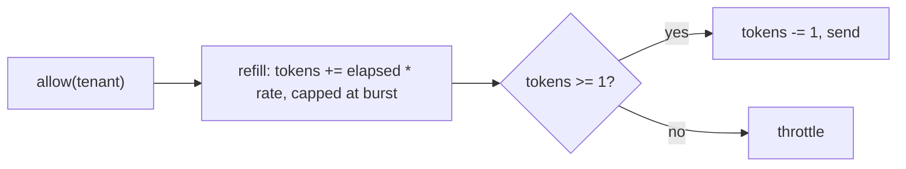

## Why

Under a flaky gateway about 9% of notifications were lost.

Two things combined to lose them. The sender retried three times one second apart, which is shorter than the gateway's typical recovery window. It also treated 429 as a hard failure. The fixed-window limiter let a tenant send its whole 100-per-minute quota in the first second of each minute. That burst produced the 429 storm the retries then had to absorb.

## What & how

The sender now retries five times with exponential backoff (0.5 s base, 16 s cap) and honors a Retry-After header. The per-tenant limiter is now a token bucket in place of the fixed window of 100 per minute. It refills at one token per second with a burst of 20.

Staging load test, 10,000 sends with 20% injected 5xx and a 429 storm at minute 3, median of three runs:

| | before | after |
|---|---|---|
| Delivery success | 91.2% | 99.1% |
| p50 latency | 120 ms | 120 ms |
| p99 latency | 3.4 s | 9.8 s |
| 429 responses per 10k sends | 1,840 | 12 |
| Worst-case wait per message | 3 s | 31 s |
| Per-tenant cap | 100/min, fixed window | 60/min sustained, burst 20 |

The trade is latency for delivery. Messages queue instead of failing, so p99 latency grows by 6.4 s and the worst-case wait by 28 s. Tenants that sent 100 messages at the top of each minute are throttled after 20 and then drain at one per second. Three tenants on staging hit this. The 99.1% is measured with both changes together, not the backoff alone. No new dependencies.

`TokenBucketLimiter` replaces `FixedWindowLimiter` in the package exports. Callers that imported the old class by name need to switch. The sustained rate drops from 100 to 60 per minute, which is a policy change for every tenant and not only for the bursty ones.

## Other changes

- `docs/BENCHMARKS.md` gains the after column and the note on the three throttled tenants.
- `README.md` spelling fix, "recieve" to "receive".

Related:
- none
