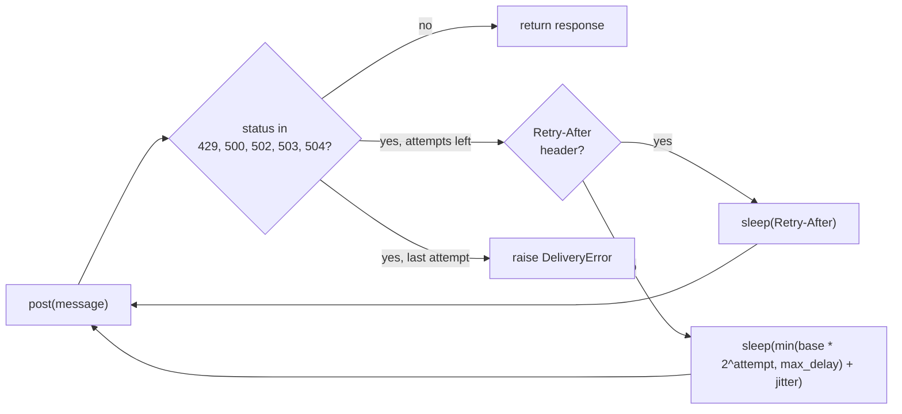

## Why

Under a flaky gateway the sender loses 9% of messages, and bursting tenants draw 1,840 throttling responses per 10,000 sends.

The sender retried three times, one second apart, and treated every 4xx as final. A 429 therefore killed the message on the spot, and a 5xx streak longer than three seconds did the same. The per-tenant limiter was a fixed window of 100 per minute. A tenant could spend the whole quota in the first second, which is exactly the burst the gateway answers with 429s.

## What & how

The sender now retries up to five times with exponential backoff and honors a `Retry-After` header. The per-tenant limiter is now a token bucket with a sustained rate of 60 per minute and a burst of 20.

The numbers below come from the load test in `docs/BENCHMARKS.md`. Each run is 10,000 sends with 20% injected 5xx responses and a 429 storm at minute 3. The table shows the median of three runs:

| | before | after |
|---|---|---|
| Delivery success | 91.2% | 99.1% |
| 429 responses per 10k sends | 1,840 | 12 |
| p50 latency | 120 ms | 120 ms |
| p99 latency | 3.4 s | 9.8 s |
| Worst-case wait per message | 3 s | 31 s |
| Per-tenant cap | 100/min, fixed window | 60/min sustained, burst 20 |

The trade: one message in eleven used to be lost, now one in a hundred is. In return the tail gets slower. p99 nearly triples and a single message can now wait 31 s instead of 3 s. Three staging tenants that burst 100 sends at the top of each minute are throttled after 20 and drain at one per second. They need a heads-up before this reaches production. The limiter's class and constructor are renamed, so any caller that imports `FixedWindowLimiter` breaks at import time.

### Retry decision



### API change

```python
# before
Sender(client, retries=3, delay=1.0)
FixedWindowLimiter(limit=100, window=60.0)

# after
Sender(client, retries=5, base=0.5, max_delay=16.0, jitter=0.0)
TokenBucketLimiter(rate=1.0, burst=20)
```

Details a reviewer should not miss, in descending importance:

- `Retry-After` is used verbatim and is not capped by `max_delay`. A gateway that answers `Retry-After: 3600` parks that message for an hour. The 31 s worst case in the load test is what the staging gateway actually sent. If a cap is wanted, it belongs in `_delay`.
- `Retry-After` is parsed with `float()`. The HTTP-date form of the header raises `ValueError` instead of a `DeliveryError`.
- Jitter defaults to 0, so the backoff is deterministic unless the caller passes `jitter`. The default sequence of waits is 0.5, 1, 2, 4 s, which sums to 7.5 s before any `Retry-After`.
- A 400 or other non-429 4xx is still returned on the first attempt. Only the retryable set changed.
- Tenants keep independent buckets. The bucket state lives in process memory, as the window counts did before, so a restart resets every tenant to a full burst.

Deliberately out of scope: no compatibility alias for `FixedWindowLimiter`, no per-tenant rate configuration, and no persistence of bucket state across processes.

No visual change. This is a library with no rendered output, so there are no screenshots.

## Other changes

- Tests: seven new cases replace the old sender and limiter tests. They cover burst-then-block, refill at rate, tenant independence, the backoff sum, `Retry-After` precedence, and non-retry of a 400.
- `docs/BENCHMARKS.md` gains the before/after columns quoted above.
- `README.md`: fix the spelling of "receive".

🤖 Generated with [Claude Code](https://claude.com/claude-code)
