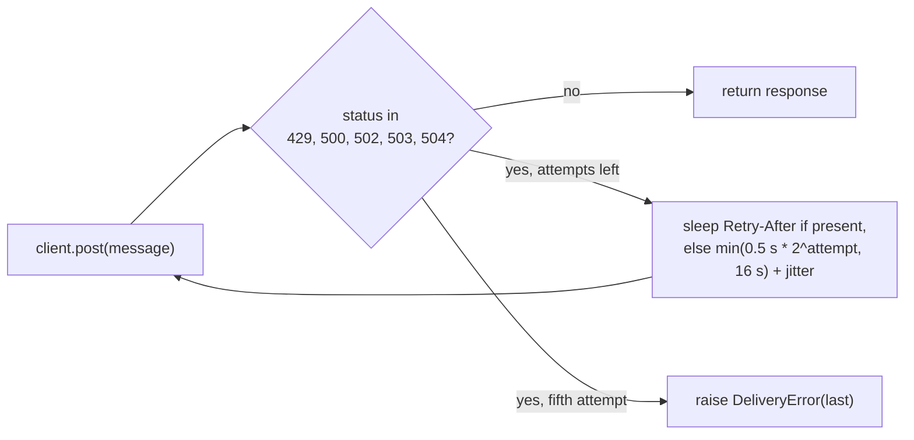

## Why

Under a flaky gateway the sender drops about one message in eleven, and bursty tenants trigger thousands of 429 rejections.

The load test in `docs/BENCHMARKS.md` runs 10,000 sends against the staging gateway. It injects 20% 5xx responses and a 429 storm at minute 3. The current code delivers 91.2% of messages and draws 1,840 rejections per run.

The old retry policy and the old limiter each cause part of the loss. The sender retries every 5xx three times with a fixed one second wait, so a gateway that is down for four seconds loses the message. The fixed-window limiter lets a tenant spend its whole 100 per minute quota in the first second, and the gateway answers the spike with 429s. The sender then hands those 429s back to the caller as if they were successes.

## What & how

The sender retries with exponential backoff and honors `Retry-After`. The limiter becomes a token bucket at 60 per minute sustained with a burst of 20.

| | before | after |
|---|---|---|
| Delivery success | 91.2% | 99.1% |
| p50 latency | 120 ms | 120 ms |
| p99 latency | 3.4 s | 9.8 s |
| 429 responses per 10k sends | 1,840 | 12 |
| Worst-case wait per message | 3 s | 31 s |
| Per-tenant cap | 100/min, fixed window | 60/min sustained, burst 20 |

The trade is a slower tail. In return nearly every message lands and the gateway sees 12 rejections instead of 1,840. Side effects beyond the table:

- Three staging tenants that send 100 messages in the first second of each minute are now throttled after 20 and drain at one per second. The same pattern in production will hit the same wall.
- `FixedWindowLimiter` is removed from the `notify` package. `TokenBucketLimiter(rate, burst)` replaces it, so every importer of the old name breaks at import time.
- A 429 is now retried instead of returned to the caller. Callers that inspected the status for 429 no longer see it unless all five attempts fail.
- No new dependencies. Backoff uses `random` and `time` from the standard library.

Details a reviewer should weigh:

- `Retry-After` is trusted as given and is not capped by `max_delay`. A gateway that answers `Retry-After: 300` makes the sender sleep five minutes. The 31 s worst case in the table comes from the staging gateway's own values.
- Jitter is off by default (`jitter=0.0`). Turning it on is a constructor argument, not a code change.
- Lowering the fixed-window limit would not have fixed the spike. Any fixed window lets a tenant spend the full quota at the window edge. The bucket caps the spike at the burst size and then enforces the sustained rate.
- Bucket state lives in process memory per tenant, as the window counts did. Several sender processes still do not share a limit. That is unchanged and out of scope.
- The limiter is not wired into `Sender`. The two stay independent classes, as before.

## Other changes

- `README.md`: fix the spelling of "receive".

🤖 Generated with [Claude Code](https://claude.com/claude-code)
