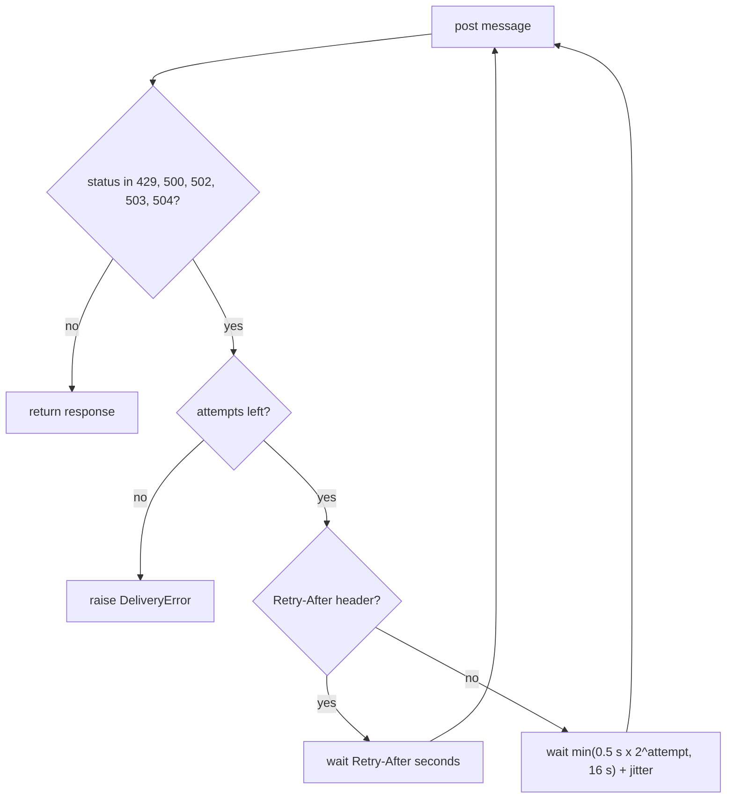

## Why

About one notification in eleven fails to deliver when the gateway returns errors or rate-limits us.

The staging load test sends 10,000 messages with 20% injected 5xx responses and a 429 storm at minute 3. The current sender delivers 91.2% of them and draws 1,840 responses of 429. It retries a 5xx three times with a fixed one-second wait. It does not retry a 429 at all. The fixed window limiter also lets a tenant send its whole minute's quota in the first second.

## What & how

The sender now retries 429 and 5xx with exponential backoff and obeys Retry-After. A token bucket replaces the fixed window for each tenant.

| | before | after |
|---|---|---|
| Delivery success | 91.2% | 99.1% |
| 429 responses per 10k sends | 1,840 | 12 |
| p50 latency | 120 ms | 120 ms |
| p99 latency | 3.4 s | 9.8 s |
| Worst-case wait per message | 3 s | 31 s |
| Per-tenant cap | 100/min, fixed window | 60/min sustained, burst 20 |

The trade: delivery rises by 7.9 points and 429 responses nearly disappear. In return the slowest messages wait longer:

- **Slower tail.** The p99 latency rises by 6.4 s. The worst single message waits 31 s instead of 3 s.
- **Lower cap for bursty tenants.** A tenant that sends 100 messages at the top of each minute is throttled after 20. It then drains at one per second. Three tenants on staging hit this.
- **Breaking API.** `FixedWindowLimiter` is removed from the package. `Sender` no longer accepts `delay`. Its default `retries` changes from 3 to 5.

The send loop after this change:

Other 4xx responses still return to the caller on the first attempt. The default `jitter` is 0, so retry timing is deterministic unless a caller sets it.

The benchmark numbers measure both changes together. The test does not split the gain between the backoff and the token bucket. The numbers are the median of three runs and live in `docs/BENCHMARKS.md`.

### Open issues for review

A local probe of the new sender found three gaps in the handling of Retry-After. The unit tests do not cover them.

- **Retry-After as a date raises.** The header may carry an HTTP date. `float()` then raises `ValueError` out of `send()`, not `DeliveryError`.
- **Retry-After is not capped.** A value of 3600 makes the sender sleep 3600 s. The `max_delay` cap of 16 s applies only to the computed backoff.
- **Retry-After applies to every retryable status.** The docstring names 429 and 503, but a 500 with the header also obeys it.

### Out of scope

- Notice to the three staging tenants that hit the burst limit.
- A non-zero default for `jitter`.

## Other changes

- The README spells "receive" correctly.
