## Why

In the staging load test, 8.8% of notifications failed to deliver when the gateway returned errors or throttled the sender.

The test sends 10,000 messages with 20% injected 5xx responses and a 429 storm at minute 3. The old sender tries a message at most three times on a 5xx response, with a fixed 1 s wait. It gives up on a 429 at once and hands it back to the caller. The old limiter gives each tenant 100 sends per fixed 60 s window. A tenant can spend that whole quota in the first second of the minute.

## What & how

The sender now retries 429 and 5xx responses with exponential backoff and obeys Retry-After. Each tenant's rate limit is now a token bucket of 60 sends per minute with a burst of 20.

Load test, median of three runs (full table in `docs/BENCHMARKS.md`):

| | before | after |
|---|---|---|
| Delivery success | 91.2% | 99.1% |
| 429 responses per 10k sends | 1,840 | 12 |
| p50 latency | 120 ms | 120 ms |
| p99 latency | 3.4 s | 9.8 s |
| Worst-case wait per message | 3 s | 31 s |
| Per-tenant cap | 100/min, fixed window | 60/min sustained, burst 20 |

Side effects:

- **Slower tail.** The p99 latency grows by 6.4 s and the worst-case wait grows from 3 s to 31 s. The median is unchanged.
- **Lower cap for bursty tenants.** A tenant that sent 100 messages at the start of each minute is now throttled after 20 and drains at one per second. Three tenants on staging hit this.
- **Breaking API.** The package exports `TokenBucketLimiter` in place of `FixedWindowLimiter`. `Sender` no longer accepts `delay` and takes `base`, `max_delay`, and `jitter` instead. Callers that use the old names break.
- **No new dependencies.** The change uses only `random` and `time` from the standard library.

How one send behaves now:

```mermaid
flowchart TD
    P["post message"] --> R{"status in 429, 500, 502, 503, 504?"}
    R -- "no" --> OK["return response"]
    R -- "yes" --> L{"last of 5 attempts?"}
    L -- "yes" --> E["raise DeliveryError"]
    L -- "no" --> H{"Retry-After header?"}
    H -- "yes" --> W1["wait Retry-After seconds"]
    H -- "no" --> W2["wait min(0.5 * 2^attempt, 16) s + jitter"]
    W1 --> P
    W2 --> P
```

Details a reviewer should not miss:

- **429 is now retryable.** Previously any status below 500 returned at once, so a 429 reached the caller as a response. Now the sender retries it. Other 4xx responses still return at once.
- **No wait after the last attempt.** Previously the sender slept once more after the final failure before it raised. Now it raises at once.
- **Jitter is off by default.** `jitter` defaults to 0, so senders that fail together can retry together unless the caller sets it.
- **Why a token bucket and not a larger window.** A fixed window of any size still lets a tenant spend its quota in one burst at the window start. The bucket caps the burst at 20 and spreads the rest at the sustained rate.

## Known limitations

- **Retry-After has no cap.** The header value bypasses `max_delay`. A `Retry-After: 600` on one response makes `send()` block for 600 s.
- **Retry-After as an HTTP date breaks the send.** The sender parses the header with `float()`. The HTTP-date form, such as `Wed, 21 Oct 2026 07:28:00 GMT`, raises `ValueError` out of `send()` instead of a retry or a `DeliveryError`.

## Other changes

- The tests for the sender and the limiter are rewritten for the new behaviour: backoff doubling, Retry-After, the non-retried 4xx, burst, refill, and tenant isolation.
- `docs/BENCHMARKS.md` shows the old and the new load-test numbers side by side.
- The README fixes the spelling of "receive".
