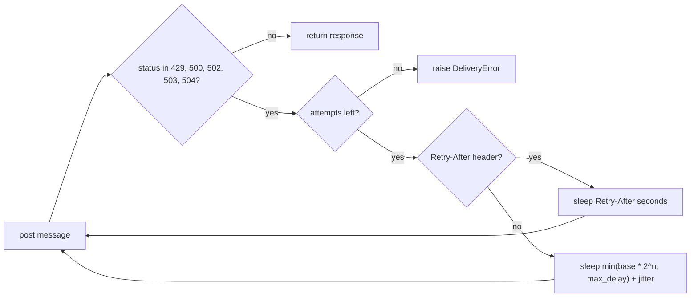

## Why

In the staging load test, 8.8% of notifications failed to deliver when the gateway returned errors or throttled us.

The load test sent 10,000 messages per run, with 20% injected 5xx responses and a 429 storm at minute 3. The old sender gave up early, and the old limiter allowed full-quota bursts:

- The sender made 3 attempts with a fixed wait of 1 second. It gave up after about 3 seconds and never retried a 429.
- The fixed window let a tenant spend its whole quota of 100 in the first second of a minute. The test counted 1,840 responses with status 429 per 10,000 sends.

## What & how

The sender now retries failed and throttled sends with exponential backoff and honors Retry-After. Each tenant now gets a token bucket of 20 that refills at 1 per second, instead of 100 per fixed minute.

| Metric, median of 3 runs | Before | After |
|---|---|---|
| Delivery success | 91.2% | 99.1% |
| p50 latency | 120 ms | 120 ms |
| p99 latency | 3.4 s | 9.8 s |
| 429 responses per 10k sends | 1,840 | 12 |
| Worst-case wait per message | 3 s | 31 s |
| Per-tenant cap | 100/min, fixed window | 60/min sustained, burst 20 |

Side effects:

- Better: delivery success rises by 7.9 points, and 429 responses drop from 1,840 to 12 per 10k sends.
- Worse: p99 latency grows from 3.4 s to 9.8 s. The worst-case wait per message grows from 3 s to 31 s.
- Who is affected: tenants that send 100 messages at the start of each minute are now throttled after 20. They then drain at 1 per second. Three staging tenants hit this.
- Breaking: callers that pass `delay` to `Sender` or import `FixedWindowLimiter` break. See the code block below.
- Risk: the sender trusts Retry-After without a cap or a parse guard. See "Known gaps".

The public API changes as follows:

```python
# Before
from notify import FixedWindowLimiter, Sender
Sender(client, retries=3, delay=1.0)
FixedWindowLimiter(limit=100, window=60.0)

# After
from notify import Sender, TokenBucketLimiter
Sender(client, retries=5, base=0.5, max_delay=16.0, jitter=0.0)
TokenBucketLimiter(rate=1.0, burst=20)
```

The retry decision for each response:



Details a reviewer may not expect:

- The sender no longer retries 501 and 505. The old code retried every status of 500 or above.
- The limiter replaces the fixed window instead of tuning it. A smaller window still lets a tenant spend its quota in one burst. The token bucket bounds the burst to 20.
- `jitter` defaults to 0. Senders that fail at the same time may retry at the same time.

This PR does not change how callers handle `DeliveryError`, and it does not add per-tenant configuration of the bucket.

## Known gaps

These gaps exist on the branch. I checked the first two with a scripted client.

- **Retry-After has no upper limit.** A header value of 3600 makes `send()` sleep for one hour. `max_delay` caps only the computed backoff.
- **Retry-After as an HTTP date raises.** RFC 9110 allows a date in this header. A date value makes `send()` raise `ValueError` instead of `DeliveryError`.
- **The worst-case wait does not match the defaults.** With the default settings, the 4 waits add up to 7.5 seconds. The benchmark reports 31 s. The run may have used other settings or long Retry-After values. Please confirm which.
- **The docstring and the code disagree.** The docstring says Retry-After applies on 429 or 503. The code applies it on every retryable status.

## Other changes

- The README fixes the spelling of "receive".
- `docs/BENCHMARKS.md` shows the before and after numbers side by side.
